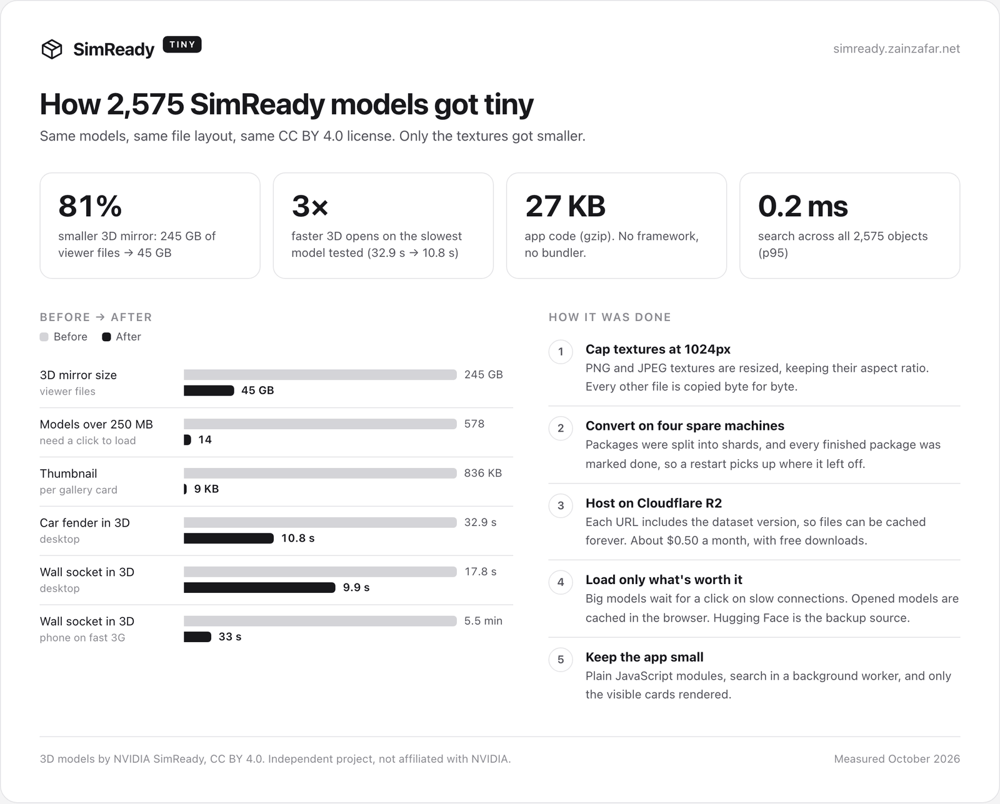
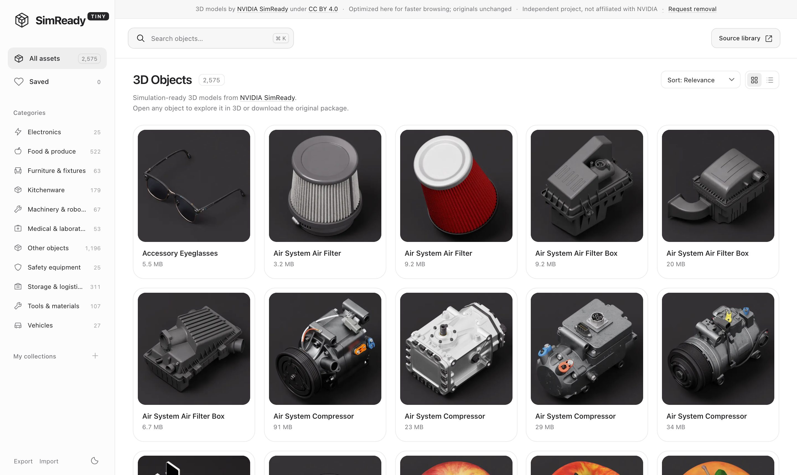

<p align="center">
  <picture>
    <source media="(prefers-color-scheme: dark)" srcset="docs/assets/logo-dark.png">
    
  </picture>
</p>

<p align="center">
  Browse NVIDIA's 2,575 SimReady 3D models in your browser.<br>
  <a href="https://simready.zainzafar.net"><b>simready.zainzafar.net</b></a>
</p>

<picture>
  <source media="(prefers-color-scheme: dark)" srcset="docs/assets/how-it-got-tiny-dark.png">
  
</picture>

Numbers and how to reproduce them: [Performance](docs/PERFORMANCE.md).

## Features

- **Instant search** across every object: typo-tolerant, local, no server.
- **Real 3D previews** from a mirror with 1024px textures (81% smaller than the originals).
- **Network-aware** loading: big models wait for a click on slow connections. A **Large** tag marks them.
- **Collections and saved items**, stored in your browser, with export and import.
- **Light and dark mode**, keyboard navigation and a mobile layout, with a ~27 KB core.

Every preview links to the original package on [Hugging Face](https://huggingface.co/datasets/nvidia/simready-assets).



## Quick start

Requires Node.js 22.12+.

```sh
git clone https://github.com/zainzafar90/simready-tiny.git
cd simready-tiny
npm run viewer:setup   # builds the 3D viewer once
npm start              # http://127.0.0.1:4173
```

The catalog and thumbnails are already in the repo.

## Commands

| Command | |
|---|---|
| `npm start` | Dev server |
| `npm test` | Unit tests |
| `npm run test:browser:memory` | Browser tests (Playwright) |
| `npm run build` | Build `dist/` |
| `npm run deploy` | Build and deploy to Cloudflare |
| `npm run catalog:sync` | Re-index the dataset |

## Configuration

Deployment settings live in [`public/config.json`](public/config.json): site name, `siteUrl`, the model mirror (`modelBaseUrl`) and an optional `contactEmail` for removal requests. Forking? Change those values and the domain in `wrangler.jsonc`. See [deployment](docs/DEPLOYMENT.md).

## Docs

[Architecture](docs/ARCHITECTURE.md) · [Deployment and model mirror](docs/DEPLOYMENT.md) · [Editing](docs/EDITING.md) · [Testing](docs/TESTING.md) · [Performance](docs/PERFORMANCE.md) · [Tagging](docs/TAGGING.md) · [Changelog](CHANGELOG.md)

## Credits

3D models and thumbnails are by [NVIDIA SimReady](https://huggingface.co/datasets/nvidia/simready-assets), licensed under [CC BY 4.0](https://creativecommons.org/licenses/by/4.0/). The mirror only resizes textures and re-encodes thumbnails. This is an independent project, not affiliated with NVIDIA. The 3D viewer is [`@huggingface/usd-web-viewer`](https://www.npmjs.com/package/@huggingface/usd-web-viewer). See [third-party notices](THIRD_PARTY_NOTICES.md).

Code is [MIT](LICENSE).
