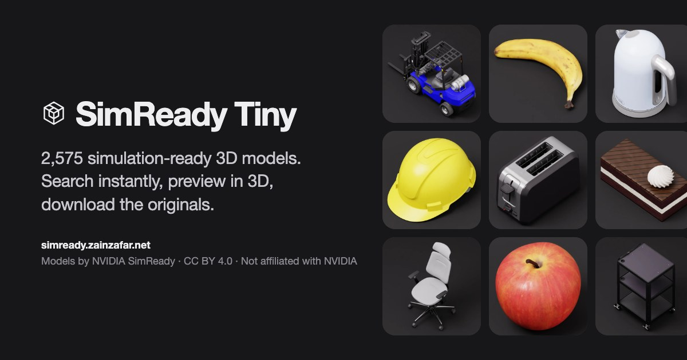

# SimReady Tiny

**Browse NVIDIA's 2,575 SimReady 3D models in your browser — instant search, real 3D previews, no downloads.**

**Live:** [simready.zainzafar.net](https://simready.zainzafar.net)



NVIDIA's [SimReady dataset](https://huggingface.co/datasets/nvidia/simready-assets) is about 470 GB of simulation-ready USD models. That's great for simulators and painful to explore. SimReady Tiny is a fast, static website for finding the model you need before you download anything:

- **Instant local search** across all 2,575 objects — typo-tolerant, runs in a Web Worker, works offline once loaded.
- **Real 3D previews** that open automatically, served from a mirror where textures are capped at 1024px: **233 GB → 43 GB (81% smaller)**, 2–3× faster than loading from Hugging Face.
- **Network-aware loading** — big models wait for a click on slow connections, Data Saver, or phones. A **Large** tag tells you which ones before you open them.
- **Collections and saved items** stored in your browser, with JSON export/import. No accounts, no analytics.
- **Light and dark mode**, keyboard navigation, mobile layout, skeleton loading, and a ~28 KB (gzip) core.

The original packages are never modified. Every preview links to the full source on Hugging Face, along with a ready-to-copy `hf download` command.

## Quick start

Requires **Node.js 22.12+**. The app itself has no npm dependencies.

```sh
git clone https://github.com/zainzafar90/simready-tiny.git
cd simready-tiny
npm run viewer:setup   # builds the optional 3D viewer once
npm start              # http://127.0.0.1:4173
```

The repository already contains the full catalog and 512/1024px WebP thumbnails, so search and browsing work right away. 3D models stream from the mirror configured in `public/config.json` and fall back to Hugging Face automatically.

## How it works

```
index.html + src/            static app: search worker, virtual grid, preview dialog
public/data/catalog.*.json   2,575 objects, hashed and cached forever
public/thumbs/               self-hosted WebP thumbnails (~32 KB per object)
public/sw.js                 caches revision-pinned model files in the browser
/vendor/usd/                 isolated USD viewer (Hugging Face usd-web-viewer), loaded on demand
R2 mirror                    shrunk copies of every model, same paths as Hugging Face
```

When you open an object, the preview shows its thumbnail immediately, then loads the 3D model in a same-origin iframe. The viewer tries the mirror first, retries once on a network hiccup, and then falls back to the original files on Hugging Face. Model URLs are pinned to a dataset commit, so files never change and are cached for a year.

## Configuration

Everything deployment-specific lives in [`public/config.json`](public/config.json):

| Key | Purpose |
|---|---|
| `name`, `subtitle` | Brand shown in the sidebar and page title. The first word is the wordmark; the rest becomes the badge. |
| `siteUrl` | Your public https URL, used for canonical and share-card tags. |
| `modelBaseUrl` | Your model mirror (https). Leave it out to load models straight from Hugging Face. |
| `contactEmail` | Shows a **Request removal** link in the attribution banner. Leave it out to hide the link. |
| `viewerUrl` | Path of the built viewer (default `/vendor/usd/index.html`). |

The Content Security Policy is generated from this file, so it only ever allows your mirror and Hugging Face.

## Forking it

1. Edit `public/config.json`: set your own `siteUrl` and `contactEmail`. Then either remove `modelBaseUrl`, or point it at your own mirror (see below). My mirror only accepts requests from my domain.
2. In `wrangler.jsonc`, change `name` and replace the `routes` custom domain with yours, or delete `routes` to deploy to a `workers.dev` URL.
3. Run `python3 tools/og/og-image.py` to regenerate the share image with your domain.

## Deploying

The site is plain static files on [Cloudflare Workers static assets](https://developers.cloudflare.com/workers/static-assets/).

```sh
npx wrangler login
npm run deploy         # builds dist/ and runs wrangler deploy
```

`npm run build` writes `dist/` with hashed app files, the current catalog only, and a `_headers` file (CSP, HSTS, COOP, cache rules).

## The model mirror (optional)

[`tools/preview-models/`](tools/preview-models) builds the shrunk copies and uploads them to a Cloudflare R2 bucket. It downloads each package's `simready_usd` files (about 245 GB; it skips `source_assets` and thumbnails), resizes textures larger than 1024px, uploads the result under the same paths, and records a per-package marker so runs can resume.

```sh
cd tools/preview-models && npm ci
npm run manifest                      # needs .cache from npm run catalog:sync
# R2_ACCOUNT_ID, R2_ACCESS_KEY_ID, R2_SECRET_ACCESS_KEY, R2_BUCKET in the environment
node src/convert.mjs --shard 1/4      # run shards 1/4..4/4 on four machines in parallel
node src/catalog-sizes.mjs            # writes real preview sizes into the catalog
npx wrangler r2 bucket cors set <bucket> --file r2-cors.json   # edit the origins first
```

On four 4-vCPU machines, the full run took about two hours. Storage costs about $0.50 a month on R2, and downloads are free. `box-run.sh` wraps a shard for remote machines. Set `PAUSE_PATTERN` if something else on the machine should pause while the shard runs.

## Scripts

| Command | What it does |
|---|---|
| `npm start` | Dev server with Cloudflare-like compression and the production CSP |
| `npm run build` / `npm run preview` | Build `dist/` / serve it |
| `npm test` | 88 Node unit tests: search, catalog, collections, load policy, security headers |
| `npm run test:browser:memory` | 39 Playwright checks against the real UI (needs `pip install playwright`) |
| `npm run check` | Syntax check of every module |
| `npm run catalog:sync` | Re-index the dataset from Hugging Face (metadata only) |
| `npm run catalog:thumbs -- --confirm-rights` | Convert source thumbnails to WebP |
| `npm run deploy` | Build and deploy to Cloudflare |

Developer tools: `tools/perf/mobile-perf.py` measures phone and 3G load times, `tools/demo/record-walkthrough.py` records a demo video, and `tools/og/og-image.py` renders the share image.

## Project layout

```
src/app.js          startup only
src/app/            page state, rendering, events, dialogs, site config
src/gallery/        virtualized grid and keyboard navigation
src/preview/        preview dialog, viewer lifecycle, load policy
src/library/        collections and import rules
src/search/         search engine and its worker
src/shared/         escaping, formatting, storage, URL state, icons
scripts/            dev server, build, catalog sync, deploy
tools/              viewer build, model mirror, perf, demo and OG tooling
tests/              Node unit tests and the Playwright browser suite
```

More detail: [architecture](docs/ARCHITECTURE.md), [editing guide](docs/EDITING.md), [testing](docs/TESTING.md), [deployment](docs/DEPLOYMENT.md), [changelog](CHANGELOG.md).

## Credits and license

- **3D models and thumbnails:** [NVIDIA SimReady](https://huggingface.co/datasets/nvidia/simready-assets), licensed under [CC BY 4.0](https://creativecommons.org/licenses/by/4.0/). The mirror and thumbnails only change texture resolution and image format; the originals are untouched on Hugging Face. This is an independent project, not affiliated with or endorsed by NVIDIA.
- **3D viewer:** [`@huggingface/usd-web-viewer`](https://www.npmjs.com/package/@huggingface/usd-web-viewer) and three.js. See [THIRD_PARTY_NOTICES.md](THIRD_PARTY_NOTICES.md).
- **Code:** [MIT](LICENSE).

If you own content shown here and want it removed, use the **Request removal** link on the site.
